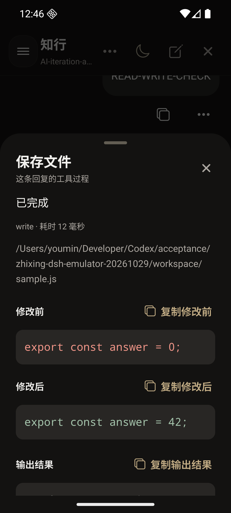
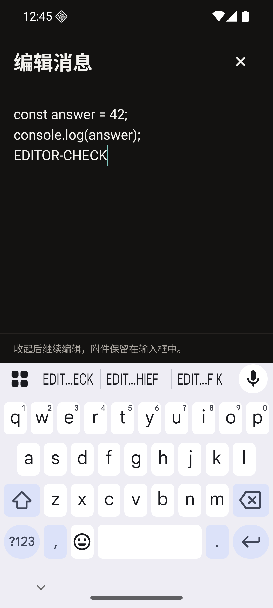
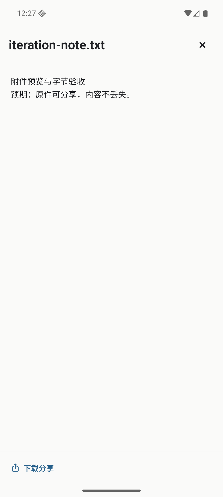
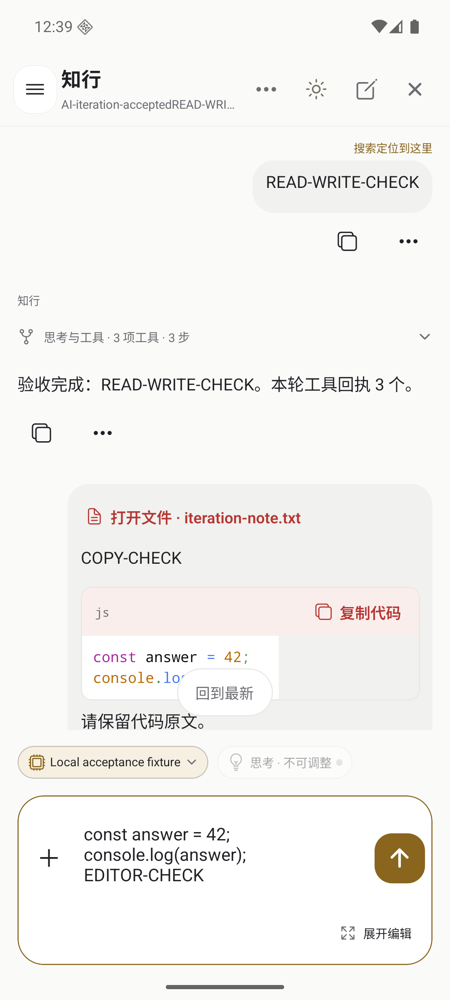

# AI 对话体验第一轮迭代

2026-10-29。依据 [RikkaHub 产品对照](CHAT-EXPERIENCE-RIKKAHUB-COMPARISON.md) 开始落实 P0：在知行现有壳子里读懂工具结果、复制和编辑长文、打开原生附件、找回具体消息。DSH 的会话、执行和工具能力继续由宿主负责。

## 本轮交付

| 场景 | 现在的行为 | 本地适配 |
| --- | --- | --- |
| 看工具结果 | 点开过程中的工具，直接查看实际输入、输出、错误和耗时；`write/edit` 有原生 diff 时显示修改前后；`bash` 显示命令和输出，退出码仅在宿主实际返回时出现。 | 复用知行 BottomSheet、日夜配色与 44dp 触摸目标；参数和原始结果信息可展开，常用结果优先。未知工具保留原名及通用详情。 |
| 复制代码 | 每个代码块显示中文复制按钮；成功写入剪贴板才显示“已复制”；失败可重试。复制保留代码原文与末尾换行。 | 保留原语法高亮；修复 Android 用户气泡中的横向代码／表格容器测量，避免出现大段空白及“回到最新”落错位置。 |
| 选取文字 | 消息菜单新增“选取文字”，打开可滚动、可局部选择的原文面板，另有复制全文。 | 使用全屏面板，避免拖动弹层与系统选字手势争抢；先关闭菜单再打开面板。 |
| 编辑长需求 | 非空输入框新增“展开编辑”，共用同一份持久草稿；收起恢复文本与光标，不发送消息。 | 保留现有多图和文件草稿；全屏编辑适配安全区及键盘。DSH 输入不继承旧业务的 20,000 字符限制。 |
| 打开附件 | DSH 消息中的文件可点开；文本和代码预览，其他文件提供下载分享，实际调用系统分享面板。 | 复用 ResourcePreview；按当前会话的原生附件引用取字节。预览展示前 256 KiB 并标明截断，下载仍取得完整文件。 |
| 改名与查找 | 对话设置中改名，宿主保存成功后才更新标题；搜索结果携带原生消息序号，进入后定位并标示命中消息；重新打开抽屉保留查询及结果。 | 改名复用当前弹层，键盘打开时一次点击即可保存；定位等待目标行实际可见，避免被自动跟随拉回底部。 |

原来的“修改后重新发送”改为“复制到草稿修改”，准确描述已有行为。本轮没有把追加新消息实现成历史编辑或重新生成。

## DSH 与文件边界

新增对话改名和原生文件接口见 [API](API.md)。文件引用必须能在当前知行会话的持久记录中找到；原件由 DSH 附件服务读取并校验完整性。手机按流写入缓存，完整下载后才分享，失败清除半成品。读取图片继续使用相同的会话归属检查。

原生 `write/edit` 返回的工作区路径并不自动成为可下载附件。本轮打通的是 DSH 已返回 `file` 引用的文件，以及用户上传到会话的文件；“改完工作区文件后自动发布产物”仍待单独接入。

默认 DSH Web profile 可能未启用搜索索引。本出口直接扫描自己的持久用户消息和助手正文，支持不区分大小写的字面匹配，每段对话返回首个正文命中；仅标题命中时打开会话，不伪造消息位置。运行时上下文、思考和工具参数不参与正文搜索。最新／最早按会话更新时间排序；现有“相关”选项暂与最新一致，完整相关度排序、多命中浏览和大历史性能优化后续补齐。

这些适配没有增加工具白名单、执行轮数、预算或插件能力限制，也不改变 DSH 的宿主配置。

## 本地验证

自动化检查覆盖移动端类型检查、lint、553 项移动端测试、Android/iOS JS bundle、6 项 DSH 插件测试及真实宿主集成。针对性回归包含剪贴板失败后重试、下载中断不分享、附件归属与完整性失败、工具调用编号跨轮复用、真实元数据、搜索序号 0 与可见行定位、展开编辑保留草稿。

真实 DSH 集成使用 `@deepseek-ai/dsh@0.2.2-alpha.2` 和确定性测试模型，验证 read → write → bash、问答续做、队列引导／撤回、取消后的真实进程退出、重启去重、图片、文件下载预览、标题及搜索位置。运行命令在 [插件说明](../plugins/dsh-zhixing/README.md)。这是本地检查，不是 GitHub Actions 或真实云模型自主开发验收。

Android 16 API 36、ARM64 Pixel 6 模拟器安装独立测试签名包 `dev.zhixing.next.dshtest.iteration`，实际检查：

| 操作 | 实际结果 |
| --- | --- |
| 读取、写入、执行命令 | 工作区 `sample.js` 从 `answer = 0` 改为 `42`，工具详情显示实际修改片段；命令输出包含 `CHECK_PASSED`。 |
| 代码复制与展开编辑 | 把代码块粘贴回原生输入框，与原文一致；展开后追加内容，收起仍在草稿中，未发送。 |
| 文件预览和系统分享 | 中文文本可读，系统分享面板收到实际文件；应用缓存中原件与输入文件逐字节一致，74 bytes。SHA-256 为 `c2c36bc928d02d2b0b01edb661b638966e01ea2578ecddc188ec958b58f985e5`。 |
| 搜索与改名 | 打开 READ-WRITE-CHECK 命中后显示原消息与定位标记；返回搜索保留关键词及结果；键盘打开时保存改名，页头收到新名称。 |
| 窄屏与主题 | 约 411dp 日间、320dp 夜间检查；全屏编辑避开 Gboard，选文出现系统选择手柄，工具详情可滚动。 |

测试 APK SHA-256：`b9a9063bc7821303ee21c80f59bf4de9ed4d07d7261a8432a72907591683b9e3`。本机原始日志、XML、截图及 APK 位于 `/Users/youmin/Developer/Codex/acceptance/zhixing-ai-iteration-20261029`。构建来自隔离验收目录，测试签名与包名未写入产品配置。

### 界面截图

以下为实际模拟器画面。工具使用真实 DSH 文件与命令执行，回复内容由确定性测试模型产生。

| 320dp 夜间工具详情 | 320dp 夜间与键盘 |
| --- | --- |
|  |  |

| 中文附件预览 | 搜索定位 |
| --- | --- |
|  |  |

## 下一轮

后续进展见[第二轮：消息编辑、重答与工作区交付](AI-CHAT-REVISIONS-2026-10-29.md)。以下保留第一轮交付时的待办边界。

P0-1 仍需补齐工作区产物发布和更丰富文件预览；P0-2 的真实消息编辑／重新回答，以及后续版本和分叉，需要映射宿主真实语义。继续保留“复制到草稿修改”，直到历史编辑链路实现并验收。

当前对话内多命中搜索、队列编辑、消息导出、图片缩放／保存、朗读等按原产品文档继续推进。大量历史消息、大字号／横屏组合、未知插件及失败工具的完整模拟器流程仍需专项覆盖；本轮未知工具和错误数据由自动化测试覆盖。未进行生产部署、正式版本发布、真机或原生 iOS 验收，也尚未证明真实云模型维护知行代码的完整闭环。
