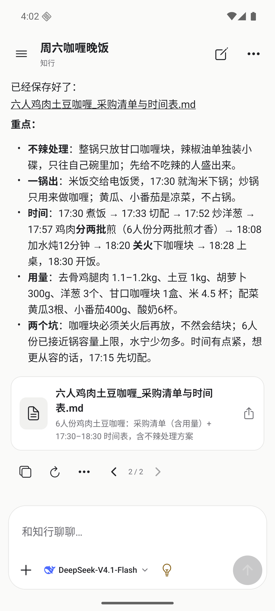
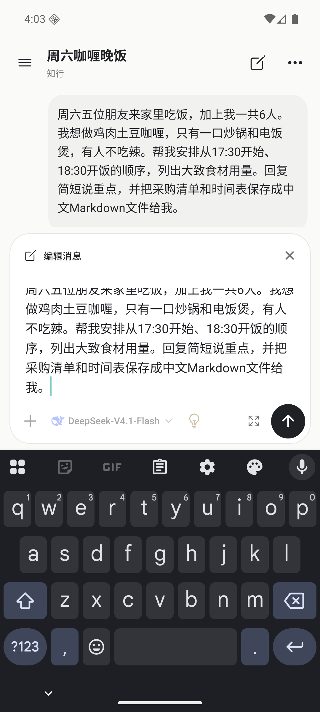
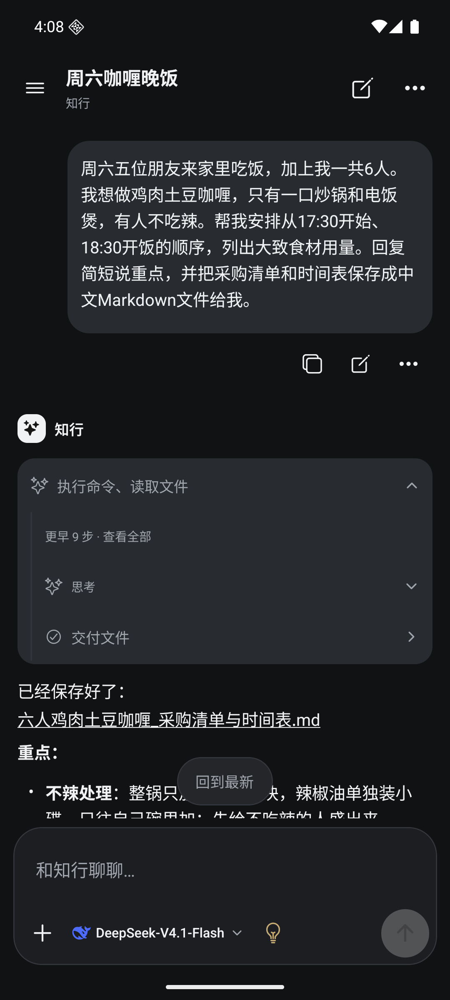
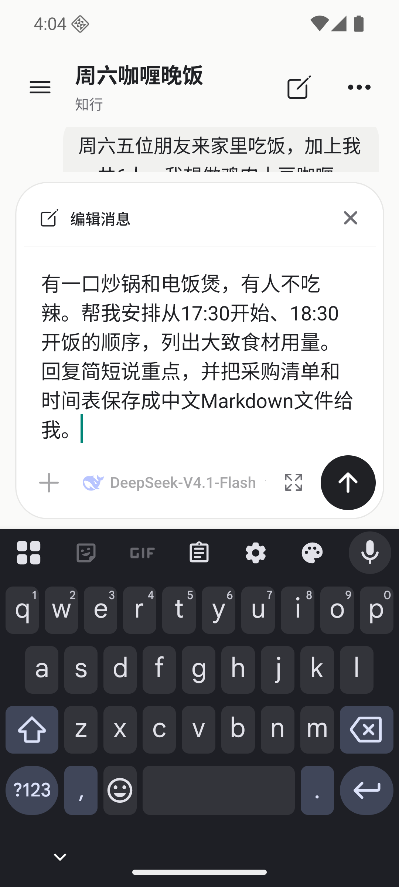
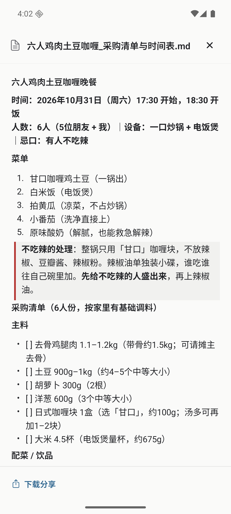
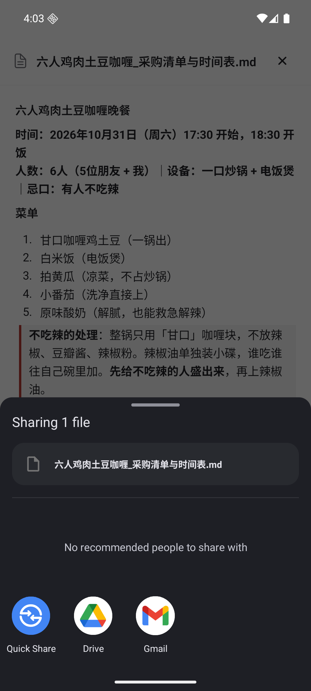

# AI 对话重做：原生 DSH 能力与真实对话验收

本轮根据用户提供的 RikkaHub 截图和知行上一轮实机截图重做聊天体验。上一轮独立编辑弹窗、手动发布文件和默认展示 XML／工作区路径，只证明了执行链路，未达到产品要求。本轮采用统一的中性色、文字层级、圆角和输入工具栏，并用真实 DeepSeek 对话检查阅读、编辑、重答、工具和交付。

## 交互与本地适配

| 场景 | 本轮实现 |
| --- | --- |
| 开始聊天 | 简洁欢迎页、单一知行标识、四个轻量话题。点击话题只填草稿。页头保留侧边栏、新对话、菜单；会话名称成为主标题。 |
| 输入 | 正文独占一行区域，附件、实际模型、支持的思考／搜索、长文展开和发送集中在下方工具栏。没有无效“不可调整”胶囊或假语音入口。窄屏选项横滑，发送固定可达。 |
| 编辑 | 用户消息下方直接点编辑，原文回到同一输入框，显示“编辑消息”与取消。普通草稿独立保留；取消或提交不会覆盖它。长文可展开，原附件可保留或移除。恢复编辑时定位到原消息，不自动滚到旧回复末尾。 |
| 重答与版本 | 助手消息下方直接点重答。回复下方左右箭头对应实际分支，能比较旧答案并继续；没有额外确认弹层。历史旧数据仍可从对话设置进入完整版本列表。 |
| 工具与思考 | 完成后折叠成具体动作摘要；展开显示真实步骤，阅读位置保持。供应商没有提供内容的空思考块不生成假步骤。文件内容、命令、修改前后和错误优先呈现，原始参数／XML／完整路径放在“技术详情”。 |
| 文件交付 | 模型原生 `present` 后自动出现文件卡片，显示中文文件名和描述。点击卡片或回复内对应文件链接打开预览，分享入口直接调用系统分享。无需用户从工具详情“发布”一次。 |
| 阅读 | Markdown 表格按内容估算列宽，局部横滑、整表复制；代码与工具使用统一底色。预览页长文件名最多两行，关闭和下载分享不挤占正文。 |

## 复用 DSH 的边界

对接官方 DSH `0.2.2-alpha.2`，核对源码提交 `f3803c96974ad4a94195fb97e5c637e9c2a3afe3`。

- 文件交付消费原生 `present`、`deliverables/presented` 和 `workspaceFiles.read/readBytes/stat`，移除 `zhixing_publish_file` 注册。移动接口只把本会话已声明的文件传到 App，不接受客户端任意路径，不额外限制宿主工具、执行轮数或文件大小。
- 当前固定版本没有直接的消息编辑／重答接口。保留必要的薄适配：用原生 `buildForkSeed`、创建／恢复会话和模型预设生成真实分支，补充版本索引与稳定请求去重。没有重写 Agent 循环。
- 原生 `present` 指向工作区当前文件，后续修改会反映到再次打开的内容；不是旧版不可变快照。旧 `/dsh/artifacts` 仅兼容旧客户端／旧回执。切换对话历史不回滚已执行的文件或外部操作。
- 版本下载必须属于当前逻辑对话，读取遵守宿主权限。读取过程核对版本；文件变化、消失、权限拒绝真实报错。原始事件仍可查阅，未知工具继续由宿主执行。

## 真实对话验收

Android 16 API 36 ARM64 Pixel 6 模拟器；独立测试签名包 `dev.zhixing.next.dshtest.iteration`；411dp 与 320dp；Gboard 实际键盘；日间与夜间。模型使用宿主实际配置的官方 DeepSeek 供应商及 `deepseek-flash`（目录显示 DeepSeek-V4.1-Flash），使用隔离会话与工作目录，不连接生产业务数据。

所有发送、编辑、重答、版本选择、预览和分享都从 App 操作；没有用接口注入助手回复。接口只用于核对原生回执、下载字节和文件一致性。

### 周末计划

真实输入周末可用时间、请求安排项目工作；将周六从 3 小时改为 2 小时，提交后回复重新安排。进入编辑前的普通草稿“另外，帮我保留一个下一步：周日晚上回顾实际完成情况。”在取消和提交后均保留。直接重答生成第三版，`3/3 → 2/3 → 3/3` 实际切换不同回复。

继续要求中文 Markdown 清单与 CSV 时间表。模型原生写文件、执行检查并 `present`，App 自动显示两张卡片；正文中的中文文件链接、文件卡片、预览和 Android 系统分享均可用。

### 周六咖喱晚饭

真实输入：三位朋友来家里吃饭，加上自己共 4 人；只有炒锅和电饭煲，有人不吃辣；要求 17:30 开始、18:30 开饭，提供用量并交付中文 Markdown 清单。

在同一输入框把“三位／4 人”改成“五位／6 人”并发送。新回复调整为 6 人份，用量、分批煎鸡肉和锅容量提示随之改变，并生成 `六人鸡肉土豆咖喱_采购清单与时间表.md`。`1/2` 仍显示四人版正文和文件，`2/2` 显示六人版。预览内人数和食材一致；系统分享显示正确中文文件名，未选择收件人或发到外部应用。

六人版原生工具回执为 bash、bash、read、write、bash、present。实际下载 **3817 bytes**，逐字节等于工作区原件，SHA-256：`30eb339751d501c3f9d9e9f9c42f8ef731e4cca82f1522b84599753c6e943ce4`。

### 视觉检查发现并修复的问题

| 验收中发现 | 修复与复查 |
| --- | --- |
| 工具展开后内容增长触发跟随，刚点开的过程被滚走 | 主动阅读过程时暂停跟随；展开后仍留在原位置。 |
| 每次轮询生成新的链接处理函数，Markdown 反复重绘，Android 无障碍树无法稳定 | 稳定回调引用；连续轮询时点击文件／工具及原生 UI 检查可稳定执行。 |
| 回复中的中文文件链接不能打开 | 只解析该回复实际交付的文件，支持已编码文件名；外部链接、路径穿越和同名歧义不获得文件权限。 |
| 供应商持久消息包含空白 reasoning 块，出现多个没有内容的“思考” | 过滤空展示块，原生记录保留；有实际文本的思考继续显示。 |
| 配置变化／重新进入后只恢复编辑文字，没有原消息位置 | 恢复编辑时等待历史加载并定位原文，键盘弹出仍保留上下文；320dp 实测取消、展开和发送可达。 |
| 长文件名占据预览页大量空间 | 改为紧凑两行页头；正文与底部分享保持可读。 |

## 截图

以下为模拟器截图，不是设计稿。展示真实模型生成内容；文本质量不作为所有场景下模型表现的承诺。

| 日间回复与原生交付 | 原输入框编辑与键盘 |
| --- | --- |
|  |  |

| 夜间工具过程 | 320dp 恢复编辑 |
| --- | --- |
|  |  |

| 中文文件预览 | 系统分享 |
| --- | --- |
|  |  |

工具详情示例：[实际写入内容与技术详情入口](images/ai-chat-redesign-20261029/tool-detail.png)。

## 验证与证据

本地门禁：`npm run typecheck`、`npm run lint`、`npm run test:mobile`（564 项）、`npm run bundle:android`、`npm run bundle:ios`、`npm run test:dsh`（17 项）、`DSH_BIN=... npm run test:dsh:integration`（9 组原生集成）及分支命名检查。原生集成使用确定性测试模型，覆盖真实工具、队列、取消、重启、附件、历史切点和交付归属；与上述真实云模型产品验收分开记录。

Android 原生测试 APK SHA-256：`c30a864fa5cc084e6bfe51b36aa1d1c49b1abfb853445136bd0a1b8963b715e4`。原始日志、UI XML、截图、原生事件、下载对照和 APK 保存在本机 `acceptance/zhixing-chat-redesign-20261029`。源码只保存代表截图与记录，不提交模型凭据、测试配置、签名或构建产物。

这次验收覆盖 Android 模拟器上的真实聊天体验。未验收物理手机、原生 iOS、生产服务或所有第三方插件卡片；复杂二进制文件仍通过下载分享打开。原生 iOS 不能由 JS bundle 成功替代。编辑当前支持保留／移除原附件，尚未加入替换附件或“只修改文字、不重答”。知行自主维护自身代码并产出 PR 的完整闭环仍需独立验收。
