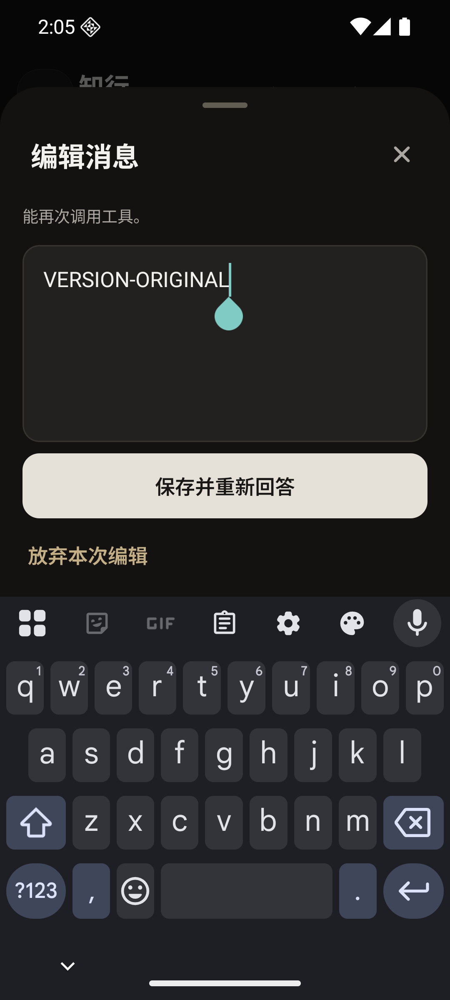
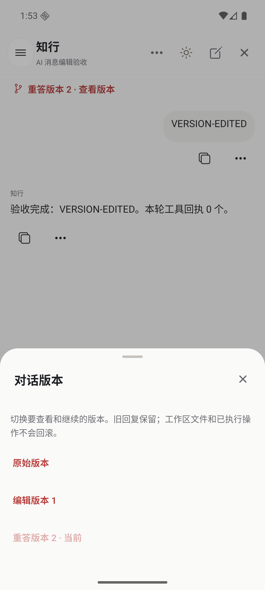
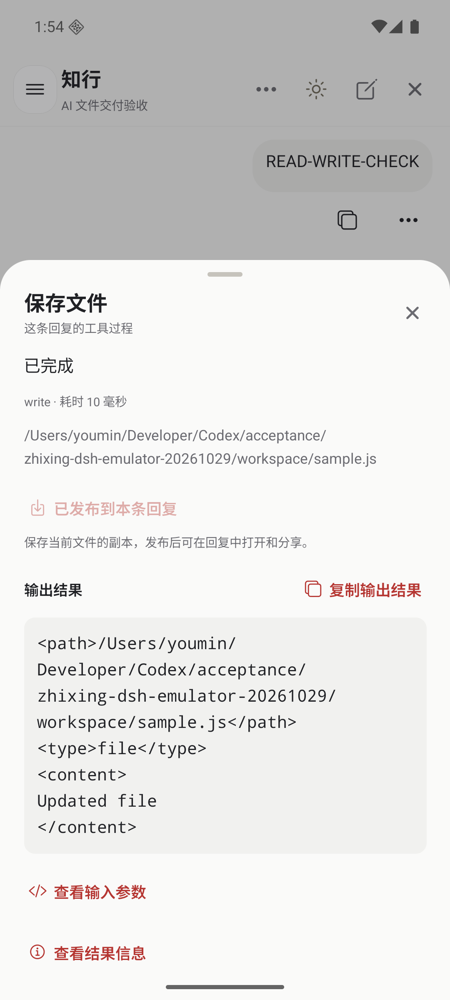
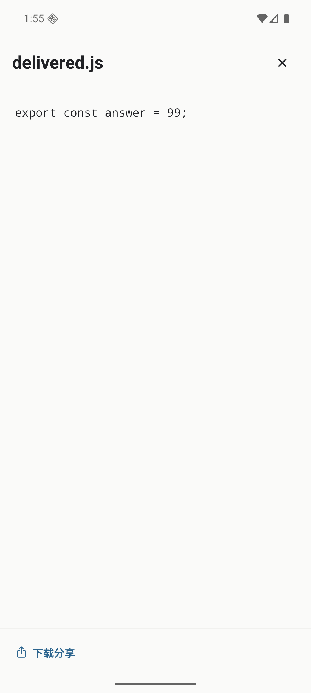

# AI 对话体验第二轮：消息版本与工作区交付

本轮接续 [RikkaHub 产品对照](CHAT-EXPERIENCE-RIKKAHUB-COMPARISON.md) 的 P0-1／P0-2：修改原消息后真正改变模型上下文、重新执行一次回答，并把实际工作区文件交到手机上。沿用知行的聊天壳子、主题、BottomSheet、原生附件预览和系统分享。

## 交付行为

| 场景 | 现在的行为 |
| --- | --- |
| 编辑早期消息 | 用户消息菜单“编辑并重新回答”打开独立编辑面板。可改文字、保留或移除原图片／文件；保存后从这条用户消息之前的原生历史创建新版本，再提交修改后的消息。原文与其后的旧回复不会混入新模型输入。 |
| 重新回答 | 助手消息菜单“重新回答”使用对应用户消息的正文与附件，在其之前的历史上重新执行；得到新的原生回答记录，旧回答留在原版本。 |
| 比较和继续 | 对话上方或设置中“查看版本”，可在原始、编辑、重答版本之间切换。之后的发送、停止、附件和模型选择都使用选中版本；逻辑对话、标题与普通草稿不变。 |
| 草稿与失败 | 编辑草稿和普通输入分开持久保存；关弹窗／重开 App 可继续编辑，取消未提交编辑不发送。提交前保存请求编号，失败重试复用原操作；“放弃重试”明确不撤销已经开始的回答。 |
| 手动交付文件 | 成功的 read／write／edit 工具详情新增“发布当前文件”。服务端从实际工具回执取路径，经 DSH 文件系统读取当前原件、保存不可变附件，再挂到对应回复；发布成功前不显示已交付。 |
| 模型交付文件 | 新增 `zhixing_publish_file` 工具与交付提示，模型可发布工作区文件，在原生工具结果返回 file 引用。App 可直接预览、下载并调起系统分享。仅返回路径不算交付。 |

编辑与重答采用 DSH 的追加式历史分支；没有原地重写日志，也没有在旧历史末尾追加一句“请修改”。使用原生 fork seed、Agent 创建／恢复、预设、模型选择、工作区关联和上传 receipt。历史切点可能包含尚未消费的队列，子会话发布前清空继承的 inbox，避免旧排队消息再次执行。

分支关系、当前版本和手动文件回执保存在宿主 `storageDomain` 的 `zhixing_chat` 域，原生事件 seq 不变。准备记录与确定的子会话 ID 在创建前写盘；请求已经入原生日志或队列时重试不会再提交。模型发布的附件留在原生 tool/result 中。协议见 [API](API.md) 与 [插件说明](../plugins/dsh-zhixing/README.md)。

## 本地适配

- 消息菜单先关闭再打开编辑／重答弹层，复用现有日夜主题与触摸尺度。编辑正文可滚动，提交／放弃按钮固定在键盘上方；320dp 夜间也可直接操作。
- 回复／用户队列处理期间不操作历史分支；后端独立检查实际运行和队列状态。关闭弹层保留修改，普通草稿不会被编辑或重答清空。
- 版本切换清空上一版本的增量事件与文件视图，缓存按版本保存历史和发布回执。并发快照使用同一份版本标识，避免把旧事件标成新版本；过期搜索结果不会定位到复用相同 seq 的另一条消息。
- 上传流不占用停止／回答问题的操作队列，保持执行中的控制可用。文件发布按块读取、前后核对源版本；变化、取消、拒绝读取或非普通文件均不能产生成功回执。

## 验证

本地检查：typecheck、lint、559 项移动端测试、15 项 DSH 插件测试、Android／iOS JS bundle，以及完整原生 DSH 集成。测试模型只控制供应商输出，历史、队列、read／write／bash、提问、取消、附件、持久化均为真实宿主服务。

针对性自动化覆盖：早期消息编辑后的模型输入、排队尾部排除、旧历史保留、重答生成新记录、重启后稳定请求去重、准备／激活落盘失败恢复、图片和文件保留、版本过期与外部版本拒绝、二进制精确发布、源文件变化、重启后发布去重、继承附件与跨会话拒绝、并发快照、上传期间停止、编辑草稿重开、缓存切换和过期搜索定位。

Android 16 API 36 ARM64 Pixel 6 模拟器使用独立测试签名包 `dev.zhixing.next.dshtest.iteration`，实际验收：

| 操作 | 观察结果 |
| --- | --- |
| 编辑第一条消息 | `VERSION-ORIGINAL` 改成 `VERSION-EDITED` 后只保留新要求与新回复；`LATER-SHOULD-DISAPPEAR` 不在新原生日志中，未发送的 `DRAFT-KEEP` 仍在输入框。 |
| 重答与切换 | 操作助手“重新回答”得到第三个版本；切回原版找回原消息与后续回复。宿主重启后版本关系、选择与已发布附件保留。 |
| 手动发布 | 发布 `sample.js` 时内容为 `answer = 42`；之后工作区改成 `99`，手机预览与实际分享缓存仍为 `42`。26 bytes，SHA-256 为 `a2098bd92b10bf8b816d24b7556b1ce8c49a879d130489065ef1051c17e042f6`。 |
| 模型发布 | 模型实际调用 `zhixing_publish_file`，回复出现 `delivered.js`，预览为后来工作区的 `answer = 99`；原发布附件未改变。 |
| 键盘与夜间 | 411dp 日间、320dp 夜间，编辑文字、收起恢复、取消与提交均可操作；窄屏固定动作避开 Gboard，说明和长正文可滚动。 |

本机原始日志、原生日志 JSON、XML、截图、下载字节与测试 APK 保存在 `/Users/youmin/Developer/Codex/acceptance/zhixing-ai-revisions-20261029`。测试配置、签名、依赖目录和 APK 不进入产品源码。

| 320dp 夜间编辑与键盘 | 对话版本 |
| --- | --- |
|  |  |

| 文件发布回执 | 模型交付的原件 |
| --- | --- |
|  |  |

## 边界

版本是整段对话的原生历史分支，目前没有 RikkaHub 的每个消息节点内左右切换，也没有“仅改文字、暂不重新回答”。历史编辑可保留／移除原附件，暂未增加新附件入口。

文件系统和外部操作由宿主管理，切换历史不会回滚已执行的改文件、命令或其他副作用；重答可能再次调用工具，界面明确说明。手动发布取点击时的当前文件，不声称恢复某次历史写入的旧字节。文本预览仍为前 256 KiB，原件下载完整；更丰富二进制预览、队列编辑等后续继续。

本轮是本地检查与 Android 模拟器验收，不是 GitHub Actions、生产部署、正式发布、真机或原生 iOS 验收；也未证明真实云模型自主维护知行代码的完整闭环。
