# RikkaHub 与知行 DSH：对话详情截图对照

日期：2026-10-29。产品判断、逐项功能和 52 个界面条目见[主文档](CHAT-EXPERIENCE-RIKKAHUB-COMPARISON.md)。

RikkaHub 为官方 3.1.1，知行为 DSH 接入后的独立验收 APK。图片来自同一台 Android 16 ARM64 模拟器，原始尺寸为 1080×2400；未重绘界面。两边的主题、语言和测试内容不同，这里比较信息结构与操作，不能据此评判同内容下的阅读效率或像素一致性。

RikkaHub 的回复由本地固定响应服务构造；知行使用此前 DSH 宿主验收的测试会话。它们证明相关 UI 能呈现，不证明云模型质量、真实代码自主维护能力或正式包已发布。

## 1. 对话正文与输入框

| RikkaHub | 知行 DSH |
| --- | --- |
| 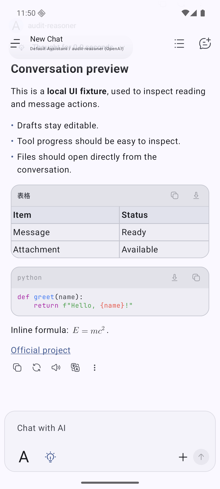 | 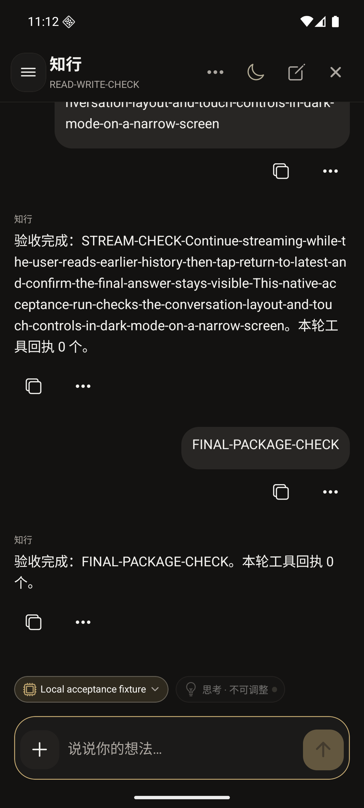 |

RikkaHub 将文字输入和底部工具包在同一容器；表格、代码有独立操作栏，回复下方直接放复制、重答、朗读、翻译、更多。知行将模型和思考状态放在输入框上方，消息下方目前是复制与更多。截图中的“验收完成”是测试回复内容，不是 App 自动判定所有工作完成。

RikkaHub 空会话另见[初始界面](images/chat-experience-20261029/rikka-empty.png)：没有模型和消息时，先保留简洁的对话空间。知行的欢迎页不在这组已建立会话的对照里。

## 2. 加号菜单

| RikkaHub | 知行 DSH |
| --- | --- |
| 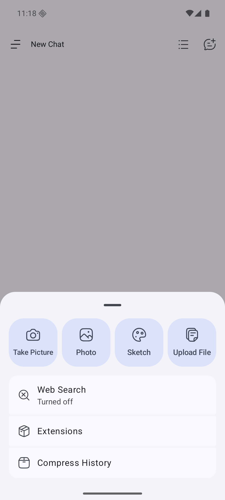 | 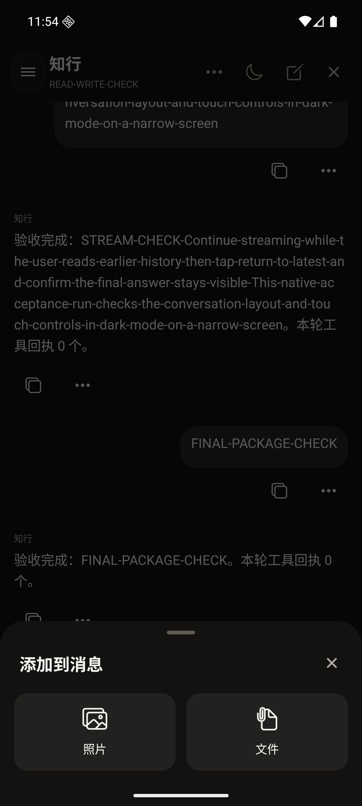 |

RikkaHub 的四个附件按钮下面还有分段操作列表；工作区和 MCP 等条件项在当前未配置环境中没有出现。知行有统一标题、右上关闭和两个大入口。可借鉴分层组织，保留知行现有照片／文件的直达路径。

## 3. 消息更多操作

| RikkaHub | 知行 DSH |
| --- | --- |
| 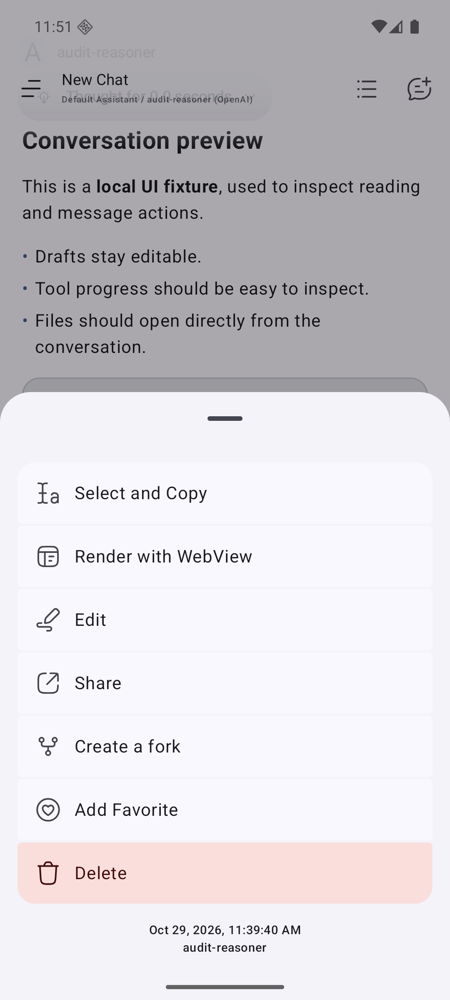 | 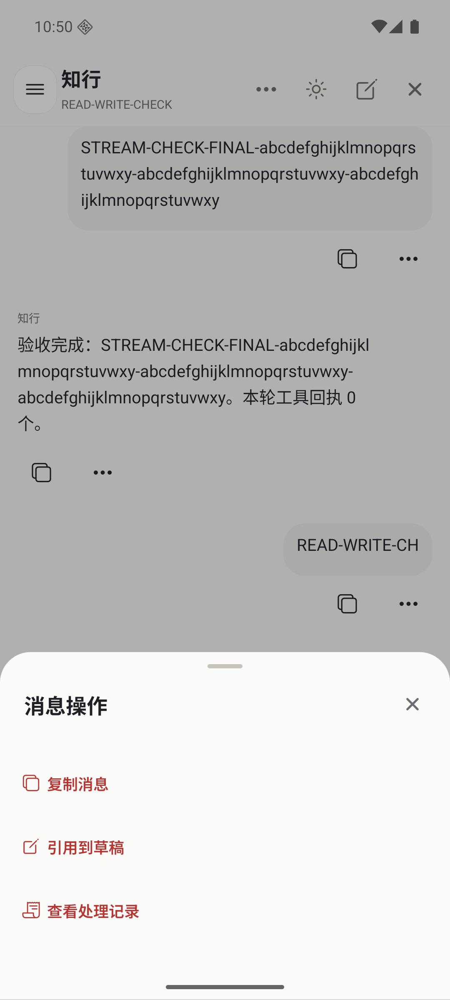 |

差距主要是动作完整度。RikkaHub 的编辑、分享、分叉和收藏有独立语义；删除使用危险色。知行的“引用到草稿”是可修改的追加文本，不能视为消息编辑或版本重答。

## 4. 模型选择

| RikkaHub | 知行 DSH |
| --- | --- |
| 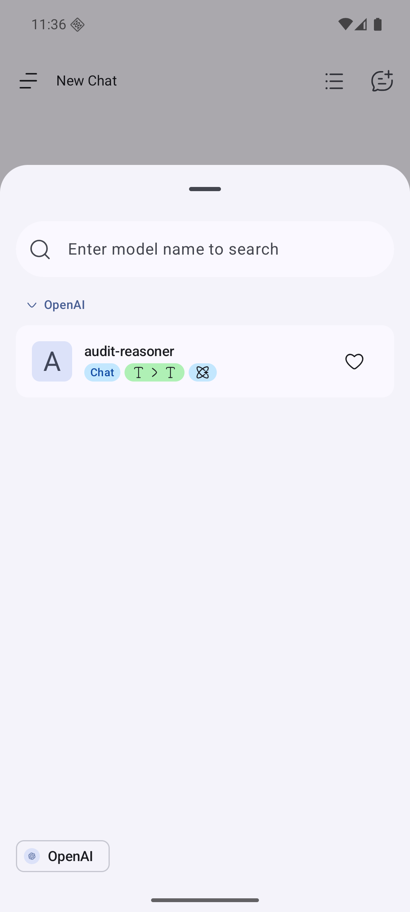 | 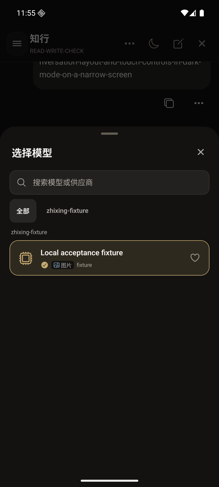 |

两边已经有较接近的基本结构。RikkaHub 底部供应商按钮用于列表定位，还支持组折叠、收藏拖动排序；知行上部是供应商筛选，保存选择要等宿主成功回执。截图各只有一个测试模型，完整多模型交互依据源码核对，不算本轮实测通过。

## 5. 设置类弹层的层次

| 联网搜索子页 | 推理深度 |
| --- | --- |
| 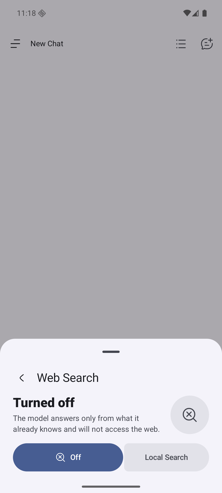 | 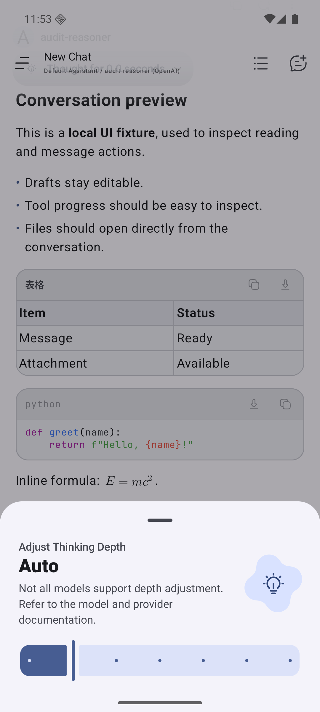 |

搜索是加号弹层里的子页，带返回；推理用大状态图形、说明和离散滑条。滑条提供可理解的档位反馈，但是否支持相应推理参数仍取决于模型。知行应继续使用宿主实际返回的档位。

| 扩展选择 | 压缩历史 |
| --- | --- |
| 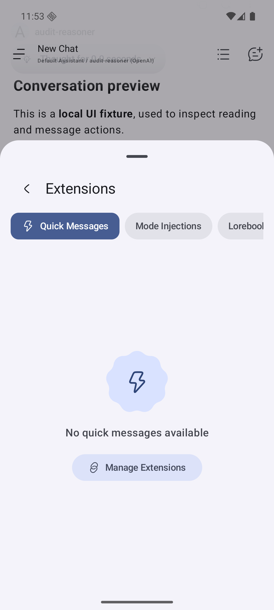 | 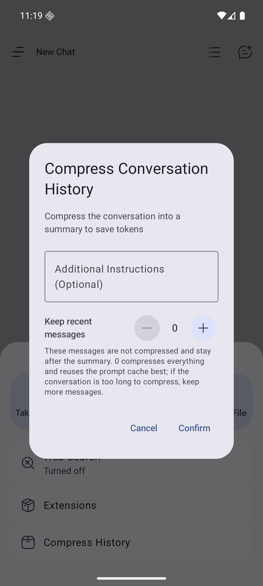 |

扩展是较高的底部列表，标签可横向切换；当前是未配置空态，未实测执行技能。压缩历史是居中短表单，包含附加要求、保留消息数量和确认／取消；本轮只查看表单，没有执行真实压缩。

## 6. 阅读专用弹层

| 选择并复制 | 翻译语言 |
| --- | --- |
| 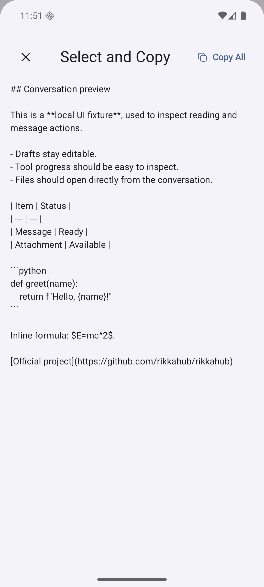 | 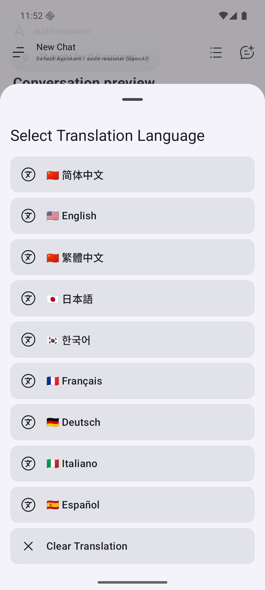 |

复制面板显示可选择的原文，有“复制全部”，没有容易与选文冲突的下拉手柄。翻译先选择目标语言，原文保留，结果另附；这组截图没有调用真实翻译模型。

## 7. 知行已有的照片流与宿主入口

| 消息照片与文件名 | 全屏图片预览 |
| --- | --- |
| 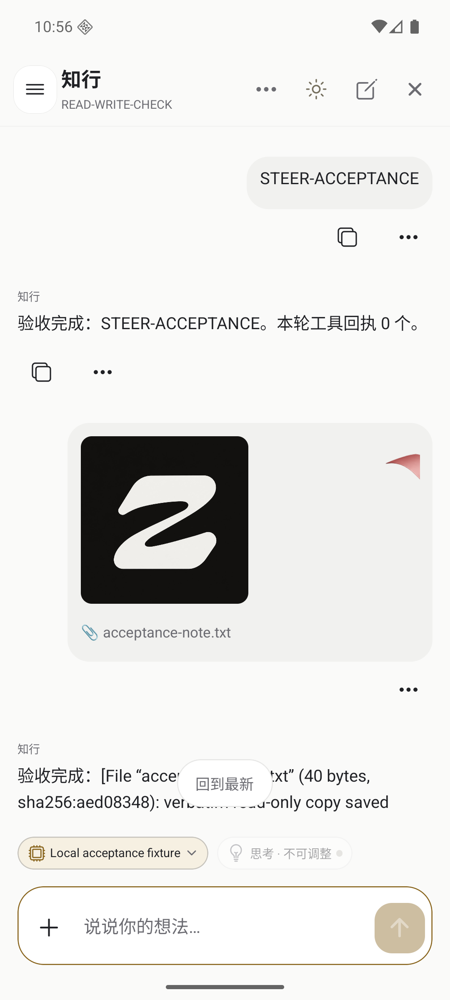 | 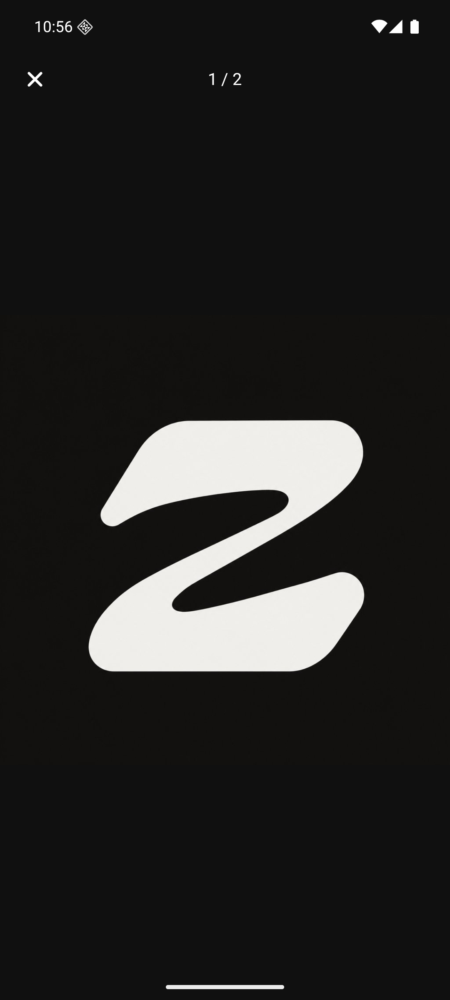 |

知行照片已经按图片显示，且可全屏翻页；测试中的第二张图本身有大面积白色区域。下面的普通文件目前只是名称，尚不能从 DSH 消息直接打开。图片预览的缩放、保存和 DSH 图片分享也未接入。多图一条消息与持久草稿应继续保留。

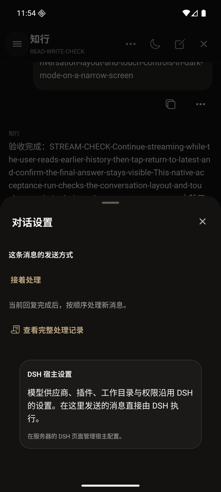

对话设置当前展示发送方式、处理记录和宿主配置说明。此测试环境没有返回宿主 `web_url`，所以只显示说明；源码在获得有效地址时才显示“打开 DSH”。不能把宿主拥有插件配置，等同于 App 已有原生插件管理面板。

## 8. 观察覆盖与来源

| 对象 | 此轮实际打开／观察 | 本文没有据此声称通过的部分 |
| --- | --- | --- |
| RikkaHub | 空会话、回复正文／表格／代码／公式、加号、模型、搜索、推理、扩展空态、压缩表单、消息菜单、选择复制、翻译语言、会话抽屉。 | 云模型、翻译质量、MCP、技能执行、工作区执行、持续语音、消息编辑与分支的端到端正确性。对应功能按 3.1.1 源码说明。 |
| 知行 DSH | 本轮重开当前会话、加号、对话设置和模型弹层；消息动作、图片和流式滚动沿用同日已核对的验收截图。 | 本轮未新增产品功能，没有把旧链路的朗读、报告预览或搜索定位当作 DSH 已验收。 |

保留的 PNG 是原图副本。完整截图、UI XML 和测试服务资料分别位于主文档列出的本机研究／验收目录。正文源码链接固定版本；后续迭代更新这份文档时，应同时更新基线、截图和已验证范围。
