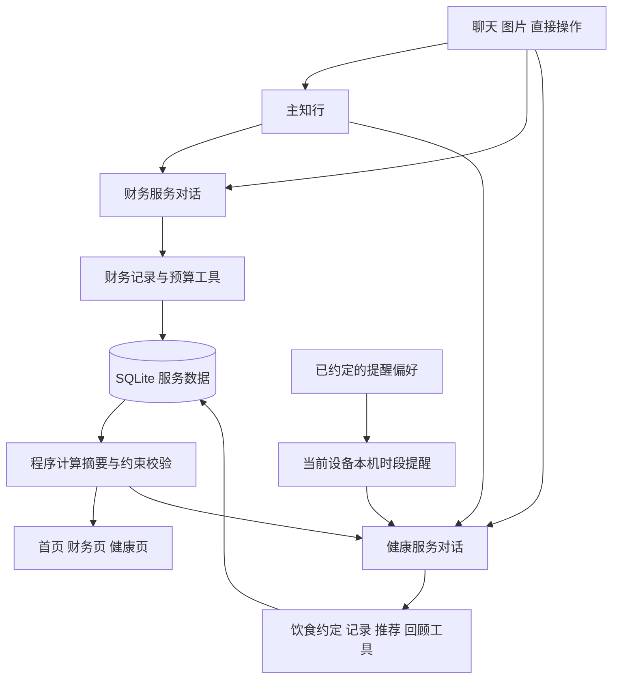

# 知行财务与饮食体重管理实施方案

状态：2026-10-14，核心代码已落地，正在验证、部署与准备 0.2.0；下面保留原实施设计与完成条件。实际命令、云模型、原生安装、手机和 Release 结果分别以[发布验收记录](RELEASE-0.2.0.md)为准，未回填项不视为完成。产品行为以[产品文档](FINANCE-HEALTH-PRODUCT.md)为准；[调研](AI-FINANCE-HEALTH-RESEARCH-2026-10-14.md)说明外部项目取舍。

本轮沿用 Expo React Native 客户端、Python 后端、SQLite 与 Deep Agents/LangGraph。优先把财务和饮食体重服务接通到独立 Android 安装版，外部项目用于借鉴已经核实的具体行为，不整体迁移其他应用。

## 当前基础与缺口

规划时基线为 `759c97f`，下表“当前依据”指规划当时的旧实现。本轮已新增 `finance_service`、`health_service`、`life_service` 及其 HTTP／工具接线、财务／健康手工表单与对话、导航收敛、本机提醒和签名构建脚本。源码实现不代表已通过云模型、部署或实体手机验收。

| 领域 | 当前依据 | 本轮改动 |
| --- | --- | --- |
| 财务 | `backend/src/zhixing_next/store.py` 的 `record_finance_observation` 和 `list_finance_observations`；仅余额与最近二十笔收支 | 业务日期、支出语义、预算、完整周期汇总、纠正及写入幂等 |
| 健康 | `src/LifePanel.tsx` 只有预填普通聊天的健康入口 | 饮食约定、实际饮食、体重、可选步数、建议与回顾 |
| Agent | `runtime.py` 为主知行装配命名子 Agent；财务有专门工具与特判 | 增加固定健康服务与工具隔离，保持主入口自动委派 |
| 聊天与图片 | `ChatPanel`、`ConversationComposer`、附件和视觉输入链路 | 两个服务继续复用，明确字段由真实记录与工具回执驱动 |
| 通知 | `src/deviceCapabilities.ts` 仅本机测试通知 | 用户约定的本机时段提醒、重排、取消、点击跳转和实机验证 |
| 通用计划 | `store.py` 调度产生 `kind=task`；不含手机远程推送 | 从产品入口退出；旧主动计划停用，保留历史和后台运行底座 |
| 发布 | CI 做测试与 JS bundle；版本配置为 `0.1.0` | 独立 release APK、固定签名和版本码、对应后端上线及发布资产 |

## 实现职责

主知行与子 Agent 使用现有运行和工具回执机制，不引入另一套编排器。健康只读取必要的餐费摘要；财务无需读取身体与饮食详情。跨服务的一条输入按可追踪的同源操作分发，各自返回实际结果。

## 数据和计算

### 财务

按需求补充交易记录与预算设置。必要信息包括业务发生日期、金额与币种、收支或转账/退款语义、日常/固定/一次性分类、来源与关联记录。金额继续使用十进制定点计算。

月预算保存预计净收入、目标结余、固定承诺、计划大件及用户独立设置的日常上限，支持默认沿用和单月覆盖。暂以自然月为首版默认周期，不为研究项目的完整账本能力建立通用会计平台。

| 指标 | 计算约定 |
| --- | --- |
| 实际总支出 | 周期内实际消费扣除关联退款；转账与还款不再重复计消费 |
| 剩余固定承诺 | 本周期固定安排扣除已经匹配的真实支付；预算与支付只计一次 |
| 剩余大件安排 | 本周期计划大件扣除已发生且匹配的支付 |
| 可用于日常的计划额度 | 预计净收入减目标结余、固定安排和大件安排；同时受用户日常上限约束 |
| 整体剩余可花 | 预计全月净收入减目标结余、全部已发生净支出和剩余固定/大件承诺，包含计划外实际支出的影响 |
| 剩余日常额度 | 整体剩余可花，与用户日常上限减已发生日常支出的结果取较小值；负值显示缺口 |
| 月底结余预测 | 已收收入与尚预计收入，减已发生支出、剩余固定/大件安排及剩余日常预测 |

日均使用明确周期与覆盖期。缺记录不能当零消费，余额观察值不当作完整账本。历史汇总与补录明细通过范围和来源衔接，避免重复覆盖；仅依据创建时间的旧观察记录不能自动转成确定的消费日期。

预计全月收入包含已经实收的部分；实收到账后抵扣相应预计项，不能再相加一次。尚未确认到账的部分继续标明预计性质。

### 健康

只建立首版所需的资料、约定、记录与建议：

- 当前资料与饮食约定：用户提供的测量值、限制、偏好、目标，来源、生效范围及必要修改信息。
- 实际饮食：时间、餐次、食物与份量描述、来源、估算性质；与计划或建议分开。
- 体重与活动：测量日期、原始单位、数值；步数可选，不自动换算运动达标。
- 建议与回顾：对应的约定和记录依据，建议内容及生成状态，用户是否采纳或调整。
- 提醒偏好：本机同步所需的时区、时段、频率、安静时间和暂停范围。

身体测量是时间序列，不因修改当前资料覆盖过去数据。规则有生效范围，AI 不能为了让回顾看起来达标而改写规则。约定的轻量留痕用于后台恢复，不建设用户必须操作的版本管理页面。

### 写入与纠正

工具写入必须有服务级幂等键，覆盖请求重发、工具重试和写入后进程中断。不同来源的疑似重复用来源匹配，不能把同日同额视为绝对重复。

同一输入同时记录餐费和饮食时，幂等标识由原输入稳定派生，跨重试、运行和主/子 Agent 路由保持不变。同一 SQLite 内优先用一个事务完成两项写入；确需分步时持久保存实际结果，只补失败项。纠正更新关联原记录，不能再次新增一套。纠正后相关摘要和建议失效并按需重算。

服务需提供不依赖模型的直接记录接口与简短表单。模型不可用但网络正常时走同一应用服务保存；断网时只保存已同步摘要与待提交草稿，明确显示未提交。恢复后复用原请求标识，不新增完整离线账本或通用同步平台。

## AI 建议的实现边界

工具提供有限范围的真实服务摘要，AI 提取、推荐与解释，程序负责金额、日期、单位和必要约束校验。新增服务修改相应工具注册、输入 schema、固定服务工具清单与权限测试，不只增加一段提示词。

推荐候选引用当前有效约定和近期记录，明确哪些是用户输入、模型估算和建议。菜单、价钱与供应只引用用户提供或实际查询到的依据。过敏与明确禁忌需候选检查；缺少成分信息时不能承诺安全。

生成建议时记录所用约定和记录修订号，最终发布前重新核对关键限制。生成期间发生纠正或规则变化，旧结果标为过期并按需重算，不能覆盖新的有效约定。修订号属于内部一致性保障，不提供用户版本管理流程。

不在首版训练食物识别模型或建立完整营养数据库。可先用现有视觉模型理解图片与文字份量，保留估算性质；用户提供营养标签时再使用标签数值。

## 监督与手机提醒

首版选用现有 `expo-notifications` 的本机排期，滚动安排未来 14 天，配合用户打开或提交记录时生成的 AI 建议和回顾。离线当天暂停先取消本机当天排期；恢复或再次进入前台时根据当前偏好同步，长期不打开 App 超出窗口后不承诺继续提醒。这能交付真实用餐时段提醒，同时保持服务端和手机的事实边界。

| 动作或状态 | 实现要求 |
| --- | --- |
| 开启提醒 | 展示提醒目的和时段，按需请求通知权限；拒绝不影响记录与建议 |
| 同步约定 | 保存本机通知标识和对应偏好版本，幂等重排，不能每次进入页面都重复排期 |
| 完成记录或修改时段 | 取消当前设备对应的旧提醒，安排仍有效的后续时段 |
| 今天不提醒 | 仅暂停指定服务/日期/时段，保留以后的约定 |
| 普通退出 App | 已同步提醒由系统负责呈现，点击进入服务后读取最新数据 |
| 时区与手机重启 | 保存用户约定的 IANA 时区，系统恢复已排通知；App 下次进入前台核对时区、偏好及排程。旅行不自动修改约定，实际手机验证重启行为 |
| 离线、权限关闭或系统限制 | 展示真实状态；不把排期 API 成功当作手机已显示 |
| 过期或长时间未同步 | 过期提醒丢弃，不集中补发；不推断用户没有进食 |

当前 `app.json` 屏蔽精确闹钟权限，因此本版承诺时段提醒。Expo SDK 57 将本地排期与远程推送分为不同能力，见[官方通知文档](https://docs.expo.dev/versions/v57.0.0/sdk/notifications/)。

本机不能实时感知其他设备的新记录，也不能接收服务器新生成的个性化消息。后续若升级为 App 关闭后的动态监督，需明确增加设备注册、投递提供方、持久待投递记录、去重/过期、失败处理与真机到达验收；不能复用旧 `schedule_task` 后宣称已有推送。无需为这一增强提前建立通用通知或任务平台。

## 页面与旧入口收敛

`AssistantApp` 导航已改为首页、财务、知行、健康、设置；首页使用真实服务摘要，财务和健康各有直接操作与对话。统一复用主题、共享控件、草稿、附件、错误与返回行为。

移除用户需要理解的聊天/任务模式切换、工作页、项目创建/管理和通用计划入口。保留主 Agent 到命名子 Agent 的委派工具，以及聊天运行、重试、取消和已有历史。旧项目会话可从历史继续查看；旧主动计划的停用应在迁移副本及实际升级中验证，不能仅隐藏页面。

## 实施顺序与验收

| 切片 | 交付内容 | 必须观察到的结果 |
| --- | --- | --- |
| 第一片 | 服务数据、财务记录与预算、确定性摘要 | 从聊天与截图记账，预算变化；纠正退款/大件后重算；重发不重复 |
| 第二片 | 健康记录、可修改饮食约定、下一餐建议与反馈 | 主聊天与健康页一致；采纳/替换和实际记录关联，回顾引用困难并改变后续建议；修改约定立即生效 |
| 第三片 | 本机监督提醒、回顾与导航收敛 | App 普通退出后实收；点击、取消、今天跳过和时区行为正确；旧计划停用 |
| 第四片 | 部署、固定签名 APK、下载安装与 Release | 离开开发电脑可完成两个真实服务闭环，覆盖升级保留数据 |

每片只增加本片需要的代码和回归，测试覆盖实际风险而非逐行复刻实现。完成第二片后锁定范围，第三、四片只解决监督和交付所需问题。

客户端执行 `npm run typecheck`、`npm run lint`、`npm run test:mobile`；源码、依赖或构建配置变化后执行 Android/iOS bundle。后端执行 `uv run pytest -q` 与 `uv run ruff check .`。写入重试、跨服务部分成功、迁移、取消和权限的变更增加集成回归。

云视觉与推荐验收使用明确同意的真实样本，覆盖中文金额、补记、饮食限制、份量不明、模型不可用及规则变更。测试模型通过不代表真实模型正确，人工检视可执行性和依据。

## 发布闭环

1. 在数据库副本验证迁移、旧计划停用、完整性与回滚恢复，备份真实数据后再部署对应后端。主机迁移不作为本次发布依赖，发布前核查实际现用主机。
2. 通过最终提交的适用本地验证与 CI；版本号、Android 版本码和签名建立稳定的覆盖升级路径，签名材料不进仓库。
3. 构建内嵌 JS 的 release APK。以同一后端版本在实体手机上断开 Metro/ADB 验证安装、启动、记录、纠正、跨 Agent 一致性、通知与重启恢复。
4. 从旧安装版覆盖升级，核对服务连接、历史和本机偏好；遇到既有签名不同，给出保留数据的具体安装路径后再执行。
5. 创建正式标签与 GitHub Release，附 APK、SHA-256、安装和升级说明。重新下载发布附件校验哈希并安装抽查。
6. 更新验收文档，分别记录自动检查、真实模型、模拟器、实体手机、后端部署和发布附件结果。任何未完成环节都保留为明确待办。

首版不以银行连接、健康平台、远程推送、Mac mini 迁移或更多图表为发布门槛；财务、饮食建议与记录、本机监督和真实安装使用是本次必须交付的内容。
